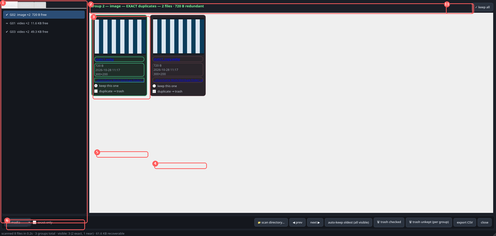
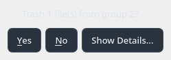
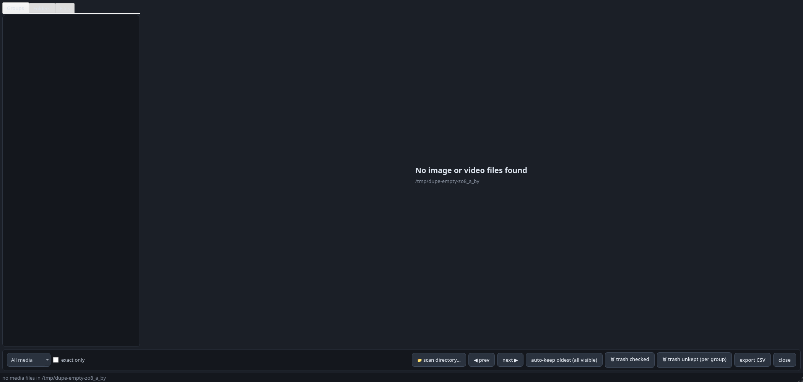

# dupe-finder — how to use

A picture-by-picture guide. Every screenshot below is a real capture of the
running app, so what you see on your screen will look the same.

> **First time on this machine?**
> `unzip dupe-finder-src-1.0.0.zip && cd dupe-finder && uv sync`, then
> `uv run dupe-finder /your/folder` (ffmpeg on PATH for videos). Full install
> details in [../README.md](../README.md).

## 1 · Start a scan

Launch it (app menu → **Duplicate Finder**, or `python3 -m dupe_finder`), then
either pick a folder in the native dialog (Ctrl+L to type/paste a path), or
start it with a folder already given: `make scan DIR=/path` /
`python3 -m dupe_finder /path`.

The window opens immediately with a scanning placeholder — it never looks
dead. Every stage shows live progress and an estimate of how long is left:

- *listing files* — walking the folder tree (indeterminate bar).
- *fingerprinting 136/460 · photo.jpg · ~28s left* — files are being hashed
  and thumbnailed in parallel; videos are frame-sampled with ffmpeg. A
  460-file folder takes roughly 30 s.
- *loaded 9,842/10,003 from cache* — rescanning a folder that has not
  changed: every unchanged file (same size + mtime) skips all decoding and
  hashing, so a 10k-file rescan finishes in seconds. The cache lives in
  `~/.cache/dupe-finder`; set `DUPE_FINDER_NO_CACHE=1` to bypass it.
- *grouping duplicates 2,100,000,000/4,900,000,000 · images 42% · ~40 s
  left* — the fingerprinting bar fills to 100%, then the heading switches
  to **🧩 Grouping duplicates …** and the bar restarts for the matching
  pass, which compares fingerprints of all files against each other. The
  pass runs in parallel across all CPU cores, so even a 100k-file library
  takes about a minute; the status line always shows the live count and
  remaining time, so you can see it working even while the bar creeps.

## 2 · The results window — what every part does

When the scan finishes you get this. The numbered red boxes are a tour map:

| # | What it is | What it does |
|---|------------|--------------|
| **1** | **Groups / Folders / Files tabs** (left) | A tabbed navigator. **Groups** — every duplicate group, sorted by wasted space. `✓` = exact (identical bytes), `~` = near (perceptual match). **Folders** — every directory in the scan with its file count, click to open it in the file manager. **Files** — every scanned file (with a filter box), click to open it in the default app. |
| **2** | **Group header** | Kind (image/video/document), exact or near, member count, redundant bytes — plus the **✓ keep all**, **🗑 trash this group**, **🔍 OCR** buttons and the in-group **sort combo** (all detailed in rows 12-15). |
| **3** | **File card** | Preview thumbnail, **filename in blue — click it and the file opens in your default viewer, brought to the front**, size, date, dimensions (videos get a 🎬 duration badge), and a **location line in blue — click it and the containing folder opens** (path shown relative to the scanned folder). The card with the red border is marked for trash. |
| **4** | **duplicate → trash** checkbox | Check the copies you want deleted. Non-keep copies are pre-checked by default. |
| **5** | **keep this one** radio | The safe copy. Auto-set to the oldest file in the group; pick any other card if you want to keep that one instead. |
| **6** | **Filters** | *All media / Images only / Videos only / Documents only* dropdown + *exact only* checkbox — narrow what groups are shown. |
| **7** | **📁 scan directory…** | Scan any other folder (background rescan, replaces the list). |
| **8** | **auto-keep oldest (all visible)** | One click: sets the keep radio to the oldest file in every visible group. |
| **9** | **🗑 trash checked (this group) / 🗑 trash unkept (all groups)** | The labels say the scope: the first trashes the checked boxes **in the group on screen only**; the second trashes the copies **in every visible group** (oldest kept; 🛡 keep-all groups skipped). Both ask for confirmation first. |
| **10** | **export CSV** | Writes every group (all members, sizes, paths, keep flag) to a CSV you choose. |
| **11** | **✓ keep all** (per group) | Keep every file in the group: **all cards turn green and the keep/trash boxes lock (disable)**, so nothing can be re-marked by accident. The row gets a 🛡 mark and **🗑 trash unkept** skips the group while it's on. Click again to restore the default marks. |
| **12** | **🗑 trash this group** (group header) | Trashes the copies **in this group only** (the kept file stays) — complete even for huge groups whose cards are still being loaded in batches. If the group is 🛡 keep-all, it tells you to turn that off first. |
| **13** | **Totals line** (above the group list) | After a scan: `N groups · M duplicate files · X recoverable` — the total possible cleanup. After each cleanup a **report window** shows how much space was freed and a per-group breakdown. |
| **14** | **Sort combo** (group header) | Re-orders the cards **of this group only**: *match* (duplicates together — see below), *name A→Z / Z→A*, *size big→small / small→big*. For huge groups the match ordering is computed in the background (a progress label appears in the header, ~1-2 min for 100k files) and the cards are usable in size order until it is ready. Your keep/trash marks survive any re-sort. |
| **15** | **🔍 OCR** (group header) | De-duplicate this group **by document text** instead of pixels — see the section below. Takes ~1.5 s per image (progress label in the header); the result is cached, so a re-scan never re-OCRs. |

Navigate groups with **◀ prev / next ▶** or the **← / → arrow keys**.

**Very large groups** — when near-duplicates chain together, one group can
hold tens of thousands of files. Cards are then shown in batches of 60 with
a **⬇ show more cards** button that loads the next batch on demand, so a
100k-file group keeps the window responsive instead of freezing it and
eating all your RAM.

The default *sort: match* order arranges a big group so it is actually
navigable: an **EXACT COPIES** section first (identical-byte files
clustered per file, name-sorted), then a **NEAR MATCHES** section where
files are chained by similarity — every version of one file sits right
next to the other, and a divider marks where the similarity breaks.
Switch the sort combo to *name* or *size* to find a specific file; your
keep/trash marks stay put through every re-sort.

### The left panel: Folders and Files tabs

The left panel is a navigator, not just the group list:

- **Groups** — the duplicate groups (default tab). Click a group to view it;
  each row shows how many MB the group wastes.
- **Folders** — every directory in the scanned tree that contains media,
  sorted by file count, e.g. `📁 characters/Judy (124 files, 31 in dupes)`.
  Click a row (or right-click → *Open folder*) to open that directory in the
  file manager — the quick way to walk a big library.
- **Files** — every scanned file, sorted by folder then name, with a
  substring filter at the top. Click a row (or right-click → *Open file* /
  *Open containing folder*) to open it. Files the scan could not read are
  marked `⚠` — hovering shows the reason (see Troubleshooting). The list
  fills in progressively (even with 100,000+ files) and the filter applies
  as you type — the window never freezes while it loads.

## 2b · Documents — de-duplication by text / OCR

The scan also picks up **documents** (`.pdf .docx .odt .epub`):

- **Exact copies** (identical bytes) group like anything else.
- **Same document, different bytes** (re-saved, re-exported, re-encoded)
  group by **text content**: the scan reads each document's text
  (PDFs via `pdftotext`, office files from their internal XML), sketches
  it with a 128-permutation MinHash, and files whose texts are ≥ 0.75
  similar (estimated Jaccard) are unioned into one group. These show as
  `~ NEAR duplicates (same text content)`.
- **Scanned PDFs** (no text layer) have nothing to read at scan time —
  they only group by exact bytes until you OCR them (below).

**🔍 OCR — de-duplicate a group by what it says, not how it looks.**
The button in the group header works on *any* group with ≥ 2 files —
most usefully on groups of scanned page images, where pixel matching
only knows the pages "look similar" but not whether they are the same
page:

1. Click **🔍 OCR**. For groups over 500 files you are asked how many
   files to read (all / first 250 / first 500) — with a time estimate.
   A progress label appears in the header (~1.5 s per image, much less
   per PDF).
2. The text of every file is extracted: images and scanned PDFs go
   through **tesseract** (scanned PDFs are rendered page by page with
   `pdftoppm` first), digital PDFs via `pdftotext`, `.docx`/`.odt`/
   `.epub` from their internal XML.
3. The cards are **re-grouped by text**: a `sort: OCR text` option
   appears in the sort combo and is selected — files of the same
   document (any encoding, crop, scan quality) sit together under an
   **OCR — N set(s)** divider; files whose text matched nothing go to a
   **UNIQUE TEXT** section.
4. The **duplicate → trash** boxes are re-marked to match: inside each
   same-document set, every file but the kept one is marked. A **report
   window** shows how many sets, how many files, and how much space the
   true duplicates free.
5. Un-mark any copy you want to keep, then **🗑 trash this group** as
   usual.

OCR results are cached in the fingerprint database
(`~/.cache/dupe-finder`), so re-scanning the folder never runs
tesseract again for a file that was already read. Short documents or
very noisy scans are the weak case — if two copies of the same page
stay in the UNIQUE section, they are probably too short or too
degraded for a reliable text match.

## 3 · Verify before you trust

"Near" groups are perceptual matches — always eyeball them:

- Click a **filename** (blue) to open that exact file in your viewer and
  compare two "identical" images side by side yourself.
- Click the **location line** (blue) to open the folder in the file manager.
- Right-click a card for *open folder / copy path*.

If two files look the same but one is the re-encoded/compressed copy, keep
the original (usually the larger one — check the sizes on the cards).

## 4 · Trash the extras

1. For each group, make sure the **keep** radio sits on the copy you want to
   keep, and the **duplicate → trash** boxes sit on the copies you want gone.
   (That's already the default state for every group.)
   If a group is a set of near-identical copies you actually want to **keep
   all of** — different crops, versions, variants — press **✓ keep all** on
   the group's header: every trash box in that group un-marks itself, the
   group row gets a 🛡 mark, and nothing in the group is ever trashed by the
   per-group button. Click it again to undo.
2. **🗑 trash checked** — trashes exactly the checked copies on the current
   group's page, or **🗑 trash unkept (per group)** — one click: trashes the
   checked copies in every visible group (the radio'd keep stays), and
   **skips groups marked ✓ keep all** — the confirmation dialog tells you
   how many were skipped.
3. A confirmation dialog shows exactly which files and how much space:

   **Yes** trashes, **No** aborts (No is the default button, so a stray
   Enter is safe).
4. Files go to the **operating system trash** (KDE/Plasma: Trash; recoverable
   by right-click → Restore). The app never hard-deletes.
5. After trashing, groups shrink and drop off the list when they fall below
   2 members; the status bar tells you what happened and via which trash path.

## 5 · Export and rescan

- **export CSV** — for a record, or to review in a spreadsheet before
  trashing anything.
- **📁 scan directory…** — jump to any other folder without relaunching.
- If the status bar ever says a file *no longer exists — rescan to refresh*,
  the folder moved after the scan; just hit **📁 scan directory…** again.

## 6 · Nothing found

A folder with no duplicates (or no media at all) shows a friendly empty page
— the app only looks at images and video files:

## How detection works (short version)

- **Exact (`✓`)** — same file size + identical blake2b hash. Guaranteed
  identical bytes, safe to trash without looking.
- **Near (`~`, images)** — 16×16 perceptual hashes (dHash + aHash) within a
  tight distance *and* similar overall colour tone. Catches re-saved,
  resized, re-compressed copies; the colour check stops different documents
  with similar text density from matching.
- **Near (`~`, videos)** — five frames sampled across the duration, hashed,
  plus a duration tolerance (max 1 s or 3%). Animated WebP is treated as
  video (Pillow frame sampling), not an image.
- **Documents** — exact by byte hash; near by **text similarity**
  (MinHash of the extracted text, Jaccard ≥ 0.75). Scanned PDFs and
  images get their text on demand via the **🔍 OCR** button
  (tesseract), which re-groups the cards by what the document says.

Thresholds are constants at the top of `dupe_finder/app.py` if you ever
want to tune them.

## Troubleshooting

| Symptom | Meaning / fix |
|---------|---------------|
| Card says *HEIC — no decoder* | HEIC files are listed and grouped, just no preview. `uv pip install pillow-heif` (or `python3 -m pip install pillow-heif`) adds previews. |
| Card says *⚠ no preview* | Unreadable/corrupt media file — it's still listed by hash. |
| Status bar says *N skipped*, or ⚠ rows in the **Files** tab | A file vanished or could not be read during the scan (typical on a Veracrypt volume where files can disappear between listing and reading). The scan now **skips that file and continues** instead of failing — hover the row for the exact error, rescan after re-mounting to pick it up. |
| *… no longer exists — rescan to refresh* | The folder moved after scanning; rescan. |
| Scan seems slow the first time | Big videos dominate the first pass. Everything is cached after that — rescan the same folder and unchanged files are skipped entirely (seconds, not minutes). |
| Viewer window opens behind | The app raises it automatically (KDE: KWin script); if you're on another compositor, click the viewer's taskbar entry once. |
